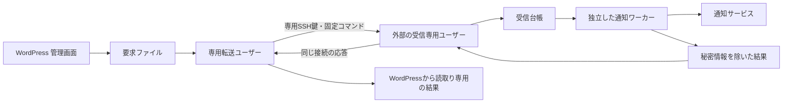

# 外部ホスト間のテスト要求・処理結果の受渡し

2026-10-19。専用環境で実装。実際のSSHと別OSユーザーを使い、通知プロバイダーだけを模擬する。本番のcommunity・dm、既存SSH設定、FTP、MySQL、実Pushover/SMTPには変更・送信を行っていない。

## 通信と信頼の境界

WordPressがテスト要求をファイルへ保存し、別ユーザーの転送プロセスが専用SSH鍵で外部ホストへ預ける。同じSSH接続で処理結果を取得する。外部からWordPressへのSSH接続や、WordPress上への新しい公開APIは不要。



SSH受信ユーザーは要求を保存し、公開用の状態レポートを読むだけ。通知ワーカーの配送DB・認証情報・稼働設定にアクセスしない。SSHコマンドからワーカーを実行しない。管理画面の設定候補を自動適用する機能も含めない。

|配置|書込み担当|読取り担当|
|---|---|---|
|WordPress側の要求ディレクトリ|WordPress、専用転送ユーザー|専用転送ユーザー|
|転送用SSH秘密鍵・接続設定|外部の管理担当|専用転送ユーザーのみ|
|WordPress側の結果ディレクトリ|専用転送ユーザー|WordPress|
|外部の受信台帳|受信専用ユーザー|通知ワーカー|
|外部のワーカー状態・認証情報・取込台帳|通知ワーカー|通知ワーカーのみ|
|外部の公開用結果|通知ワーカー|受信専用ユーザー|
|プログラム・固定設定・authorized_keys|管理担当（root等）|必要な実行ユーザー|

通常のバックアップ署名鍵・管理用SSH鍵・heartbeat用SSH鍵を流用しない。専用公開鍵を1サイト専用の受信設定へ結び付ける。ホスト公開鍵は既存の信頼できる管理経路で照合し、専用known_hostsへ固定する。初回接続時の自動承認はしない。

## 配置する設定

以下のパス・ホスト名は配置例。一般利用者向けの自動セットアップはまだなく、OSユーザー・グループとSSH設定は管理担当が用意する。

### 外部ホスト：受信専用設定

`/etc/owr/receiver.json`（管理者所有、受信ユーザーから変更不可）：

```json
{
  "site_id": "管理画面のsite_id",
  "inbox_db": "/var/lib/owr-inbox/inbox.sqlite",
  "report_file": "/var/lib/owr-public/status.json"
}
```

受信台帳のディレクトリは受信ユーザー所有・専用共有グループ・2750。台帳は0640、通知ワーカーはそのグループで読取りだけを許可する。公開結果のディレクトリは逆に通知ワーカー所有・同グループ・2750とし、受信ユーザーは読取りだけにする。ワーカーの秘密情報を置くディレクトリは0700。

受信用のauthorized_keysは管理者所有・受信ユーザーから変更不可の固定場所へ置く。公開鍵行の先頭例：

```text
restrict,command="/usr/bin/python3 /opt/owr/notification-transfer.py receive --config /etc/owr/receiver.json" ssh-ed25519 専用公開鍵
```

パスワード認証を無効にし、TTY・エージェント転送・TCP転送を許可しない。固定コマンドは `SSH_ORIGINAL_COMMAND` が `notification-exchange` のときだけ受け付ける。SFTP・任意シェルコマンドは拒否する。コード・設定の親ディレクトリも受信ユーザーから変更できない権限にする。既存の管理ログインや業務用ユーザーの設定を置き換えない。

### WordPress側：転送専用設定

転送ユーザー専用の0700ディレクトリに次の設定と0600のSSH秘密鍵・known_hostsを置く。

```json
{
  "site_id": "管理画面のsite_id",
  "host": "worker.example.invalid",
  "user": "owr-ingress",
  "port": 22,
  "identity_file": "/var/lib/owr-relay/id_ed25519",
  "known_hosts": "/var/lib/owr-relay/known_hosts",
  "requests_dir": "/var/lib/owr-requests",
  "relay_lock": "/var/lib/owr-relay/relay.lock",
  "status_file": "/var/lib/owr-status/status.json"
}
```

known_hostsの名前は `owr-notification-` にsite_idを続けたHostKeyAliasを使う。

```text
owr-notification-管理画面のsite_id ssh-ed25519 照合済みホスト公開鍵
```

WordPress要求ディレクトリはWordPress所有・専用共有グループ・2770で、転送ユーザーをそのグループへ追加する。要求は0640。PHPが作る要求ロックは読取りFDでも排他ロックを取得できるため、既存0644ロックも扱う。転送側が先に作る場合は0660。WordPress側の結果ディレクトリは転送ユーザー所有・WordPress用グループ・2750、結果は0640。WordPressから結果ディレクトリを書き換えられないことを確認する。

```php
define('OWR_NOTIFICATION_REQUEST_DIR', '/var/lib/owr-requests');
define('OWR_NOTIFICATION_STATUS_FILE', '/var/lib/owr-status/status.json');
```

手動で1往復するコマンド：

```sh
python3 tools/notification-transfer.py exchange --config /var/lib/owr-relay/config.json
```

これだけでは通知サービスへ送信しない。要求がなくても外部結果を取得する。接続失敗・応答不正は非0終了する。

### 外部ホスト：ワーカー取込みと公開用結果

取込設定（ワーカーが読む固定ファイル）：

```json
{
  "site_id": "管理画面のsite_id",
  "inbox_db": "/var/lib/owr-inbox/inbox.sqlite",
  "worker_requests": "/var/lib/owr-worker/requests",
  "stage_db": "/var/lib/owr-worker/stage.sqlite",
  "stage_lock": "/var/lib/owr-worker/stage.lock"
}
```

公開用設定：

```json
{
  "site_id": "管理画面のsite_id",
  "worker_status": "/var/lib/owr-worker/status.json",
  "public_status": "/var/lib/owr-public/status.json"
}
```

以下をワーカーユーザーで順に実行し、途中で非0終了した場合はその周期の後続処理を止める。`notification-live.py run` は実接続設定で使うと実通知を送るため、今回の検証では模擬プロバイダーを使用した。

```sh
python3 tools/notification-transfer.py stage --config /etc/owr/stage.json
python3 tools/notification-live.py run --state /var/lib/owr-worker/delivery \
  --requests /var/lib/owr-worker/requests --status /var/lib/owr-worker/status.json
python3 tools/notification-transfer.py publish --config /etc/owr/publish.json
```

その後、WordPress側で再び `exchange` すると処理結果が画面へ届く。将来のタイマー設定では転送とワーカーをそれぞれ独立実行する。今回は常設タイマーを登録していない。

テスト要求の取込ジョブは、通常のバックアップ監視・独立watchdogとは別に扱う。受渡し障害を理由に通常監視まで停止する依存関係を作らない。

## 破損・中断・再送時の扱い

- SSH受領の `stored` は外部台帳への同期保存完了。通知サービスの受付・端末受信とは別。
- 応答には今回のnonceと各要求のSHA-256を含め、クライアントが照合する。確認できない要求はWordPress側へ残す。確認後も元ファイルが書き換わっていれば削除しない。
- 同じ要求ID・同じ内容の再送は保存を重複させない。同じIDで内容が異なる要求は拒否し、バッチ全体をロールバックする。
- ワーカー取込台帳を配送DBとは別に保持する。処理済みファイルが消えても取り込み直さない。取込途中の停止は内容を照合して再開する。
- 転送は1回20件、WordPress側の要求は100件まで。受信台帳は1サイト10,000件まで。上限で新規保存を拒否するが、状態取得と同一要求の再送は続けられる。台帳を無断消去して容量を空けない。
- 要求は識別子・設定版・作成時刻だけ。任意URL、宛先、本文、ファイルパス、認証情報を受け付けない。期限300秒・有効宛先・設定版・60秒間隔は独立ワーカーが再検証する。
- 外部結果は許可した状態・件数・識別子のみ。APIエラー本文・鍵・receipt番号等は転送しない。古い結果へ巻き戻さず、ワーカーの完了時刻を転送時刻で置換しない。通信が続いていてもワーカーが停止すれば画面は古い状態として表示する。
- 入出力サイズ、SSH待ち時間、受信側のCPU・メモリを制限する。シンボリックリンクやFIFOを要求ファイルとして読まない。

SSH鍵を盗まれた場合にこのサイトのテスト要求を提出される可能性は残る。ワーカーの宛先制約・頻度制限・通常優先度は維持されるが、これを侵害元の健全性証明には使わない。WordPress画面も侵害時の信頼の起点ではない。

## 専用環境での検証

```sh
python3 -m unittest discover -s tests -p 'test_notification_transfer.py' -v
python3 tools/run-notification-transfer-lab.py --output /tmp/owr-transfer-new-result
```

既存の `owr-external-lab:local` イメージを使い、受信ホスト・WordPress側転送ホストの2コンテナを新規作成する。内部専用ネットワークで、公開ポート・外部通信はない。既存DockerネットワークとWSLの経路に重複しない専用サブネットを選び、試験終了時に今回のコンテナ・ネットワークだけ削除する。SSH鍵は試験専用の一時鍵であり、既存鍵や実通知キーは使わない。

実SSHによる往復、応答喪失後の再送、二重送信防止、版不一致、任意コマンド・SFTP・転送・未登録鍵・ホスト鍵不一致の拒否、OSユーザー間の読書き権限を確認する。WordPress画面そのものは前段の画面試験で確認した同じ要求・結果形式を利用する。今回は二台間の通信境界の試験であり、本番の到達性や常設運用を確認したものではない。

次に残るのは、本番へ配置する際のホスト・ユーザー・鍵の割当てと失効手順、常設実行・転送停止監視、台帳の安全な保管整理。既存の独立watchdogへ本番接続する前に、転送とワーカーそれぞれの停止を検知する試験が必要。

定期実行と転送・ワーカーの停止監視は、後続の[定期実行・役割別停止検知](notification-runtime.md)で専用環境実装済み。本番の有効化は引き続き未実施。
